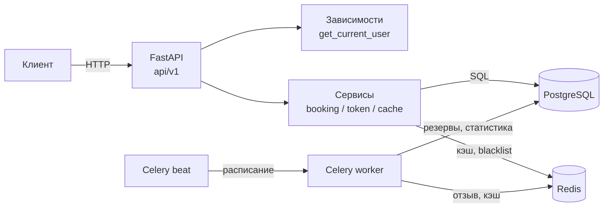

# Ticket Booking API

Сервис бронирования мест в кинотеатре: удержание места на 5 минут, оплата с идемпотентностью, автоматическое освобождение просроченных резервов.


## О проекте

Проект вырос из одного вопроса: **как не продать одно и то же место дважды, когда за него одновременно борются десятки запросов**. Всё остальное — аутентификация, кэш, фоновые задачи, миграции — построено вокруг этого сценария.

Что внутри:

- **Конкурентное бронирование**: пессимистичная блокировка `SELECT … FOR UPDATE SKIP LOCKED` плюс партиционный уникальный индекс как вторая линия защиты.
- **JWT с ротацией**: access/refresh, отзыв конкретной сессии через blacklist по `jti` в Redis и отзыв всех сессий через `users.token_version`.
- **Redis-кэш** карт мест с TTL 5 секунд и инвалидацией при бронировании.
- **Celery beat**: освобождение просроченных резервов, напоминания, почасовая аналитика.
- **34 теста** (pytest + httpx), включая тест гонки на одно место.

## Стек

| Слой | Технологии |
|---|---|
| API | FastAPI 0.115, Pydantic v2, pydantic-settings |
| БД | PostgreSQL 15, SQLAlchemy 2.0 (async), asyncpg, Alembic |
| Кэш и отзыв токенов | Redis 7 (redis-py asyncio) |
| Фон | Celery 5.4, Celery beat, Flower |
| Аутентификация | JWT (python-jose), bcrypt (passlib) |
| Инфраструктура | Docker Compose, JSON-логи |
| Тесты | pytest, pytest-asyncio, httpx (ASGI transport) |

## Архитектура



```
src/
├── api/
│   ├── deps.py              # текущий пользователь, проверка admin
│   └── v1/
│       ├── auth.py          # регистрация, логин, refresh, logout
│       ├── booking.py       # удержание и оплата места
│       └── seat.py          # карта зала, статистика кэша
├── core/
│   ├── config.py            # настройки из окружения
│   ├── database.py          # async engine и сессии
│   ├── security.py          # JWT и хеширование паролей
│   ├── redis_client.py
│   └── logging_config.py    # JSON-логи
├── models/                  # users, halls, seat, booking
├── schemas/                 # Pydantic-схемы запросов и ответов
├── services/
│   ├── booking_service.py   # удержание, оплата, конечный автомат статусов
│   ├── token_service.py     # blacklist, ротация, версии токенов
│   └── cache_service.py     # кэш карты зала
├── tasks/                   # Celery: очистка, напоминания, аналитика
└── main.py                  # приложение, lifespan, CORS
```

Слои не пересекаются: роутеры знают только про сервисы, сервисы — про модели и сессии, работа с Redis и Celery спрятана в отдельных модулях.

## Запуск

```bash
git clone https://github.com/SrcLite/ticket_project.git
cd ticket_project

cp .env.example .env
# SECRET_KEY обязателен — без него приложение не стартует:
python -c "import secrets; print(secrets.token_urlsafe(48))"

docker compose up -d --build      # postgres, redis, app, celery worker/beat, flower
docker compose exec app alembic upgrade head
```

Сервисы после старта:

| Адрес | Что |
|---|---|
| http://localhost:8000/docs | Swagger UI |
| http://localhost:8000/health | Проверка живости |
| http://localhost:5555 | Flower, `admin:admin` |

Остановить: `docker compose down`. Удалить данные вместе с томом: `docker compose down -v`.

## API

Время везде в UTC. Формат ошибок — стандартный FastAPI: `{"detail": "..."}`.

| Метод | Путь | Доступ | Ответы |
|---|---|---|---|
| `POST` | `/api/v1/auth/register` | — | `201`, `409` дубликат email, `422` валидация |
| `POST` | `/api/v1/auth/login` | — | `200` пара токенов, `401`, `403` деактивирован |
| `POST` | `/api/v1/auth/refresh` | refresh в теле | `200` новая пара, `401` токен отозван/использован |
| `POST` | `/api/v1/auth/logout` | refresh (+ access опционально) | `204` |
| `POST` | `/api/v1/auth/logout-all` | access | `204`, инкремент `token_version` |
| `GET` | `/api/v1/auth/me` | access | `200` профиль |
| `POST` | `/api/v1/hold/{seat_id}` | access | `200` бронь на 5 минут, `400` место занято |
| `POST` | `/api/v1/confirm/{booking_id}` | access + `Idempotency-Key` | `200` оплачено, `400`, `422` нет заголовка |
| `GET` | `/api/v1/halls/{hall_id}/seats` | — | `200` карта зала, `404` |
| `GET` | `/api/v1/cache/stats` | admin | `200`, `401`, `403`, `503` Redis недоступен |
| `GET` | `/health` | — | `200` |

### Примеры

```bash
# Регистрация
curl -s -X POST http://localhost:8000/api/v1/auth/register \
  -H "Content-Type: application/json" \
  -d '{"name": "Иван", "email": "ivan@example.com", "password": "secret123"}'

# Логин
curl -s -X POST http://localhost:8000/api/v1/auth/login \
  -H "Content-Type: application/json" \
  -d '{"email": "ivan@example.com", "password": "secret123"}'
# → {"access_token": "eyJ...", "refresh_token": "eyJ...", "token_type": "bearer", "expires_in": 900}

# Карта зала (публично)
curl -s http://localhost:8000/api/v1/halls/1/seats
# → [{"id": 1, "status": "free"}, {"id": 2, "status": "reserved"}]

# Удержать место на 5 минут
curl -s -X POST http://localhost:8000/api/v1/hold/1 -H "Authorization: Bearer $ACCESS"
# → {"status": "success", "booking_id": 34, "reserved_until": "2026-10-08T12:05:00", "message": "..."}

# Оплатить (повтор с тем же ключом не создаст вторую продажу)
curl -s -X POST http://localhost:8000/api/v1/confirm/34 \
  -H "Authorization: Bearer $ACCESS" \
  -H "Idempotency-Key: 7f0d3a1e-9c1b-4f2e-8a55-2b9c1f0d3a1e"
# → {"status": "success", "booking_id": 34, "message": "Бронь успешно оплачена"}

# Обновить токены (старый refresh после этого недействителен)
curl -s -X POST http://localhost:8000/api/v1/auth/refresh \
  -H "Content-Type: application/json" -d '{"refresh_token": "'"$REFRESH"'"}'

# Выйти на всех устройствах
curl -s -X POST http://localhost:8000/api/v1/auth/logout-all -H "Authorization: Bearer $ACCESS"
```

## Конкурентность: как не продать место дважды

Задача: два клиента одновременно нажимают «Забронировать» на место №1. Продать нужно ровно один раз.

**Первая линия — блокировка строки:**

```python
select(Seat).where(Seat.id == seat_id, Seat.status == SeatStatusEnum.FREE) \
           .with_for_update(skip_locked=True)
```

Запрос берёт `FOR UPDATE` на строку места. Второй запрос не ждёт, а благодаря `SKIP LOCKED` просто не видит заблокированную строку — и сразу получает «место занято». Никакой очереди и таймаутов: под нагрузкой запросы не сериализуются, а отказ приходит мгновенно.

**Вторая линия — ограничение в схеме БД:**

```sql
CREATE UNIQUE INDEX uq_booking_seat_active ON booking (seat_id)
WHERE status IN ('reserved', 'sold');
```

Это *партиционный* уникальный индекс: он запрещает две активные брони на одно место, но **не мешает** забронировать место повторно после истечения резерва — в отличие от обычного `UNIQUE (seat_id)`, который превращал бы таблицу броней в «одна бронь на место за всё время». Даже если логика в приложении когда-нибудь ошибётся, БД не даст создать вторую активную бронь: `IntegrityError` превращается в понятный `400`.

**Жизненный цикл брони:** `PENDING → RESERVED → SOLD | EXPIRED | CANCELLED | FAILED`. Переходы проверяются конечным автоматом в `BookingService.can_transition`, недопустимый переход — ошибка, а не тихая запись.

**Просроченные резервы** освобождает фоновая задача `release_expired_seats` (раз в минуту): ставит `EXPIRED`, возвращает место в `free`, сбрасывает кэш зала.

## Аутентификация и отзыв токенов

| Токен | Время жизни | Назначение |
|---|---|---|
| access | 15 минут | доступ к API, передаётся в `Authorization: Bearer` |
| refresh | 30 дней | только для получения новой пары |

- **Ротация**: каждый `/refresh` атомарно «сжигает» предъявленный refresh (`SET NX` по `jti`), поэтому повторное использование старого токена возвращает `401`, а два параллельных запроса не могут оба получить новую пару.
- **Точечный отзыв**: `/logout` добавляет `jti` access- и refresh-токенов в Redis-blacklist с TTL, равным остатку их жизни.
- **Отзыв всех сессий**: `/logout-all` инкрементирует `users.token_version`; токены с прежней версией отвергаются. Версия хранится в БД, поэтому отзыв не зависит от доступности Redis.
- **Роли**: `users.role`; админские ручки закрыты зависимостью `get_current_admin`.

## Фоновые задачи

| Задача | Расписание | Что делает |
|---|---|---|
| `release_expired_seats` | каждые 60 с, очередь `high_priority` | освобождает места с истёкшим резервом, сбрасывает кэш зала |
| `send_expiry_reminders` | каждые 60 с | напоминания о скором истечении резерва |
| `aggregate_hourly_stats` | в начале каждого часа | продажи и истечения за час → `stats:hourly` в Redis |
| `health_check` | каждые 300 с | проверка живости worker'а |

Дополнительно зарегистрирована `cleanup_old_bookings` (удаление броней старше 30 дней) — вызывается вручную, в расписание не входит.

## Тесты

```bash
# тестовая БД создаётся один раз
docker compose exec postgres psql -U postgres -c "CREATE DATABASE tickets_test"

docker compose run --rm tests                                   # весь набор
docker compose run --rm tests pytest -k booking -v              # только про брони
docker compose run --rm tests pytest -m unit                    # быстрые, без БД
docker compose run --rm tests pytest --cov=src --cov-report=term-missing
```

Сервис `tests` перед прогоном применяет миграции к `tickets_test` и запускает pytest. Тесты работают в изолированном окружении: отдельная БД, отдельная база Redis (`REDIS_DB=2`), таблицы очищаются перед каждым тестом, поэтому прогон не задевает данные разработки.

Что покрыто:

- **Бронирование** — успешное удержание, отсутствие токена, несуществующее место, занятое место, гонка двух одновременных запросов (проходит ровно один).
- **Оплата** — успешный сценарий, отсутствие `Idempotency-Key`, повторная оплата с тем же ключом, просроченный резерв, уже проданная бронь.
- **Аутентификация** — валидация регистрации, дубликат email, вход с неверным паролем и для деактивированного пользователя, `/me` с валидным/битым/отсутствующим токеном, ротация refresh, logout.
- **Карта зала** — выдача мест, зал без мест, кэш: заполняется после первого запроса и сбрасывается при бронировании.
- **Фоновые задачи** — освобождение просроченных резервов и сохранность активных.

## Ключевые решения и компромиссы

- **`SKIP LOCKED` вместо оптимистичной блокировки.** При оптимистичном подходе проигравший запрос узнаёт о конфликте только после попытки записи; здесь отказ приходит на этапе чтения. Для брони билетов важнее предсказуемо быстрый отказ, чем максимальная пропускная способность на редких конфликтах.
- **Партиционный индекс вместо распределённого лока.** Лок в Redis пришлось бы освобождать вручную и он не переживает падение процесса; ограничение в схеме БД — единственная гарантия, которую нельзя обойти логикой приложения.
- **Версия токена в БД, blacklist в Redis.** Версия отзывает всё и сразу и не зависит от Redis; blacklist даёт точечный отзыв одной сессии с автоматическим истечением записей.
- **TTL кэша зала — 5 секунд.** Карта мест терпит небольшую задержку, а горячий эндпоинт перестаёт бить в БД на каждый запрос. Инвалидация при бронировании сокращает окно устаревания.
- **Резерв живёт 5 минут, освобождение — задача, а не проверка при чтении.** Так просроченные брони освобождаются даже если к ним никто не обращается.

